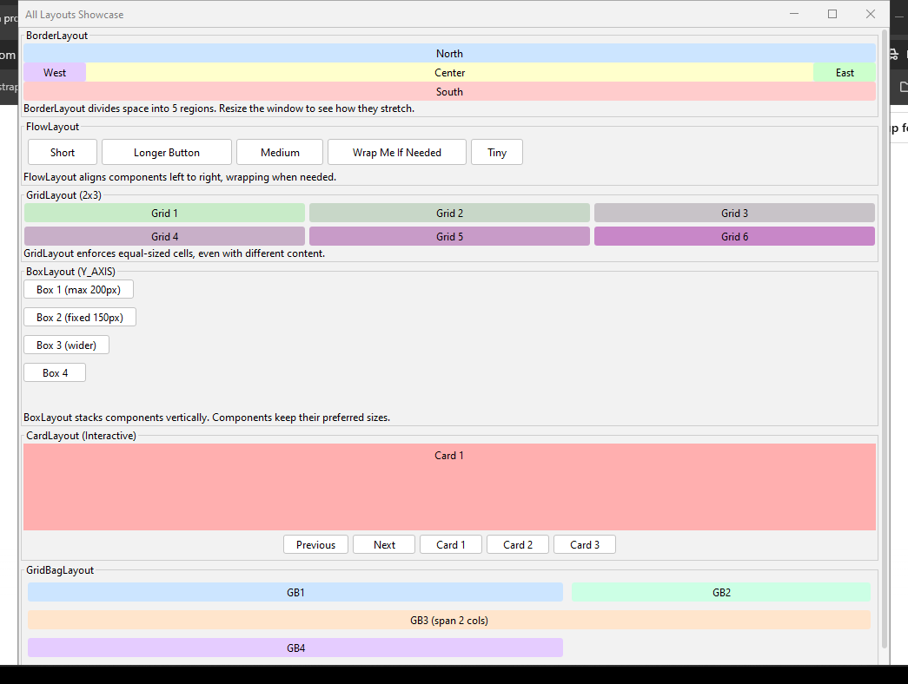

# 💡 Java Swing Layouts Showcase


An interactive, educational demo that showcases the behavior and usage of major Java Swing layout managers. It is designed for **students**, **educators**, and **developers** who want a concise, hands-on reference for building Swing UIs.

📦 `BorderLayout`, `FlowLayout`, `GridLayout`, `BoxLayout`, `CardLayout`, and `GridBagLayout`.

Built with **Java 11** and **FlatLaf** for a modern UI.



---

## 📁 Project Structure

```plaintext
JavaSwingLayouts/
├── exe/                     # Windows executable (.exe) generated via Launch4j
│   └── JavaSwingLayouts.exe
├── lib/                     # External libraries (FlatLaf)
│   └── flatlaf-3.6.jar
├── nbproject/               # NetBeans project metadata
├── src/
│   └── LayoutsShowcase/     # Java source package
│       └── LayoutShowcase.java
├── dist/                    # Generated JAR file (JavaSwingLayouts.jar)
├── build.xml                # Ant build script
├── manifest.mf              # Manifest file
├── LICENSE                  # MIT License
├── README.md                # This file
└── ApplicationDemo.png      # Screenshot of the application
```
---

## 🚀 How to Run

### ✅ Option 1 – Run Executable (Windows Only)
Navigate to the `exe/` folder and double-click:

### ✅ Option 2 – Run via NetBeans
1. Open the project in **NetBeans**.
2. Make sure JDK 11 is configured.
3. Run the `LayoutShowcase.java` file.

> ☕ **Requires:** Java Development Kit (JDK) 11+

---

## Table of contents

- [💡 Java Swing Layouts Showcase](#-java-swing-layouts-showcase)
  - [📁 Project Structure](#-project-structure)
  - [🚀 How to Run](#-how-to-run)
    - [✅ Option 1 – Run Executable (Windows Only)](#-option-1--run-executable-windows-only)
    - [✅ Option 2 – Run via NetBeans](#-option-2--run-via-netbeans)
  - [Table of contents](#table-of-contents)
  - [Overview](#overview)
  - [Features](#features)
  - [Requirements](#requirements)
  - [🙋 Contributing](#-contributing)
  - [📜 License](#-license)

---

## Overview

This small demo application includes examples for the following layout managers:

- `BorderLayout`
- `FlowLayout`
- `GridLayout`
- `BoxLayout`
- `CardLayout` (interactive view switching)
- `GridBagLayout`

Each demo is implemented in `src/LayoutsShowcase/LayoutShowcase.java` and demonstrates typical use cases and resizing behavior.

## Features

- Clear, interactive examples of major Swing layouts.
- Modern appearance using FlatLaf (optional dependency in `lib/`).
- Resizable UI to demonstrate layout responsiveness.
- Simple entry points for experimentation and extension.

---

## Requirements

- Java Development Kit (JDK) 11 or later
- Optional: NetBeans IDE (project metadata provided) or another Java IDE

---

## 🙋 Contributing

Contributions and feedback are welcome. Please follow these steps:

1. Fork the repository.
2. Create a feature branch (`feature/my-change`).
3. Add tests or demonstrate the change in the UI where applicable.
4. Open a pull request with a clear description of the change.

For issues or feature requests, use the GitHub issues page:
https://github.com/Mavros-Lykos/java-swing-layouts-showcase/issues

---

## 📜 License

This project is released under the MIT License. See `LICENSE` for details.

---

** 👤 Author**: Mavros-Lykos — https://github.com/Mavros-Lykos

